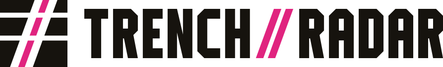

# TRENCH//RADAR brand



## The mark

The mark is three time slices of a signal, as on a waterfall display:
- The slices thin toward the top: the heavy bottom one is the past, the thin top one is now.
- A double channel is cut through them. This is the trench. Its two cuts are the `//` of the
  name, drawn in negative space.
- The channel leans as it rises, the way a pattern drifts across time.
- The house pink inside the channel is the signal running through the trench.

It sits in the Signal Press language (`docs/DESIGN.md`): flat ink on paper, hard edges, no glow,
no gradients. It avoids radar rings, crosshairs, coins, rockets and charts.

The wordmark is not set in a font. It is drawn as polygons, with condensed chamfered capitals in
the spirit of the app's League Gothic headlines. The `//` uses the same 20° slant as the mark's
cuts.

**Source of truth:** `scripts/brand_assets.py`. Every file below is generated from its geometry,
and so is the inline masthead lockup in `web/index.html`. Change the geometry there and rerun the
script; don't edit the outputs by hand.

```
python scripts/brand_assets.py
```

## Files

| File | Use |
|---|---|
| `web/brand/lockup.svg` · `-night` · `-mono-black` · `-mono-white` | Mark and wordmark side by side: headers, documents, title cards |
| `web/brand/wordmark.svg` · variants | Wordmark alone, where the mark is already present |
| `web/brand/mark.svg` · variants | Mark alone, transparent |
| `web/brand/mark-on-paper.svg` · `mark-on-night.svg` | Mark on the Day and Night edition papers |
| `web/icons/favicon.svg` | Browser tab. A small-size drawing (wider trench) that follows the browser's light or dark theme |
| `web/icons/favicon.ico` | 16, 32, 48 px for browsers that ask for `/favicon.ico` |
| `web/icons/icon-180.png` · `icon-192.png` · `icon-512.png` | Apple touch icon and installed-app icons, on paper |
| `web/icons/icon-maskable-512.png` | Android adaptive icon: the mark kept inside the central safe zone |
| `web/icons/trench-radar.ico` | Windows exe icon, 16–256 px. 48 px and under use the small drawing |

## Colour

| Role | Day | Night | Mono |
|---|---|---|---|
| Ink (slices, wordmark) | `#16130e` | `#efe8d8` | `#000000` / `#ffffff` |
| Signal (channel, `//`) | `#e0247f` | `#ff4fa3` | same as ink |
| Paper behind icons | `#eee8da` | `#121926` | — |

In the app, the masthead lockup is painted by the edition's own tokens: `--ink` and
`--novel-ink`. It changes with Day and Night and needs no separate file.

## Use

- **Minimum sizes:** 16 px for the mark (use the favicon drawing), and 18 px tall for the
  lockup.
- **Clear space:** at least the height of the top slice on every side.
- **One colour:** use the mono files. The mark keeps its meaning without pink, because the
  trench is cut, not coloured.
- **Don't:** add gradients, glows, shadows or outlines, rotate it, re-space the slices, set the
  wordmark in another typeface, or put the full-colour mark on a busy or mid-tone background.

## How it was made

Three concepts were drawn and compared in Day and Night, and at 64, 32 and 16 px inside light and
dark browser tabs:
- **Waterfall cut:** the one chosen.
- **Step trace:** a level line crossing a `//` gate. Too thin at favicon size.
- **Bracketed monogram:** too close to the viewfinder cliché.

The chosen concept was refined against a second problem: three even bars crossed by slashes read
as a `#`. Thinning the slices toward the top fixed that.

Three MIT-licensed projects were studied for method. Nothing was installed from them, and none of
their artwork or code was used:
- **mcpware/logoloom:** concept → variations → full kit; light/dark previews; the 64/32/16 px
  legibility check.
- **neonwatty/logo-designer-skill:** flat-fill SVG conventions and named groups.
- **yakew7/DesignHub:** the variant set (colour, mono, inverted, app icon) and previewing favicons
  inside real browser tabs.

Rasterising uses Pillow, already an app dependency, so no new tools are needed.
